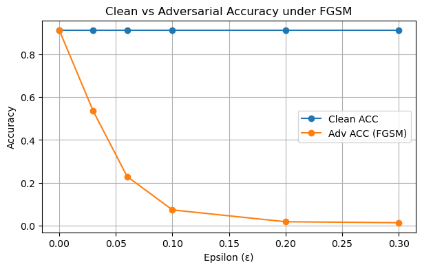
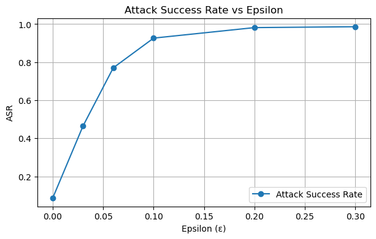
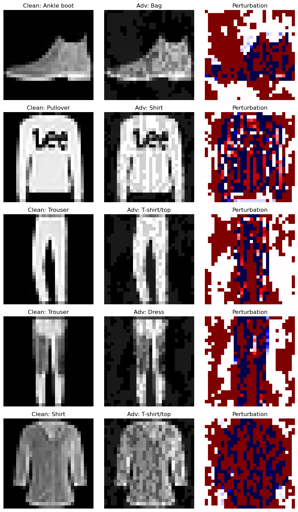

# Adversarial Machine Learning: FGSM Attack on Fashion-MNIST

Course project for **CS 685, Foundations of Data Science** (University of Alabama at Birmingham, Fall 2025), completed by **Team StrawHats**.

We train a LeNet-style CNN on Fashion-MNIST, then attack it with the **Fast Gradient Sign Method (FGSM)** to measure how quickly small, nearly invisible perturbations destroy accuracy.

**Stack:** Python, PyTorch, torchvision, NumPy, Pandas, Matplotlib

## Key results

The baseline CNN reaches **91.3%** clean test accuracy (5 epochs, Adam, lr = 0.001, batch size 128).

| ε | Clean acc (%) | Adversarial acc (%) | Attack success rate (%) |
|---|---|---|---|
| 0.00 | 91.30 | 91.30 | 8.70 |
| 0.03 | 91.30 | 53.51 | 46.49 |
| 0.06 | 91.30 | 22.96 | 77.04 |
| **0.10** | 91.30 | **7.37** | **92.63** |
| 0.20 | 91.30 | 1.85 | 98.15 |
| 0.30 | 91.30 | 1.39 | 98.61 |

- At ε = 0.10 (10% of the pixel range), accuracy falls from 91.3% to 7.37%.
- Even ε = 0.03 cuts accuracy by nearly 40 points.
- Attack success rate rises monotonically and exceeds 98% for ε ≥ 0.20.

Attack success rate (ASR) is defined as `1 - adversarial accuracy`, so at ε = 0 it equals the clean error rate (8.70%).





## Method

FGSM is a single-step, white-box attack that nudges each pixel in the direction that increases the loss:

`x_adv = clip(x + ε · sign(∇ₓ L(θ, x, y)), 0, 1)`

**Model:** 2 conv layers (32 and 64 filters, 3×3), 2×2 max-pooling, dropout 0.25, and 2 fully connected layers (128, 10). About 1.2M trainable parameters.

The notebook is organized in three tasks: (1) setup and baseline training, (2) FGSM implementation, single-ε evaluation and perturbation visualization, (3) multi-ε robustness sweep with plots and summary tables.

## Run it

```bash
python -m venv .venv
source .venv/bin/activate        # Windows: .venv\Scripts\activate
pip install -r requirements.txt
jupyter notebook fgsm_fashion_mnist.ipynb
```

The dataset downloads automatically. Running the notebook writes figures and CSV tables to `adv_project_fgsm_outputs/`. It runs on CPU in a few minutes; a fixed seed (2025) is set for reproducibility.

## Repository contents

| Path | Description |
|---|---|
| `fgsm_fashion_mnist.ipynb` | Full implementation: training, FGSM attack, evaluation, plots |
| `report/FGSM_Project_Report.pdf` | Complete written project report |
| `figures/` | Result plots used in this README |

## Team

Anusha Devanagundi Lakshmisha · Sai Poojith Reddy Gunukula · Shivathmika Gonti · Suchithra Nalladimmu

Instructor: Dr. Xi Li, UAB.

## Takeaways and next steps

A classifier with over 91% clean accuracy has essentially no robustness to gradient-based attacks. Natural extensions are adversarial training, stronger multi-step attacks (PGD), and testing transfer attacks across architectures.
